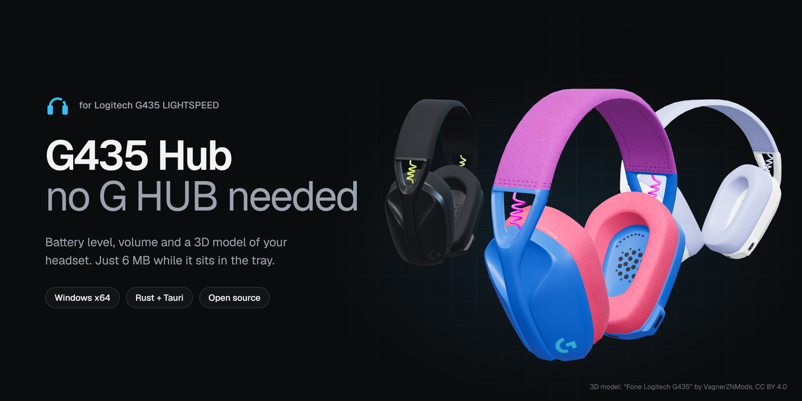
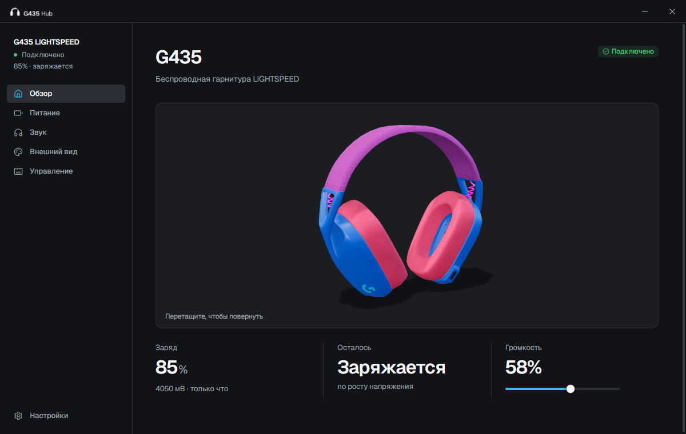
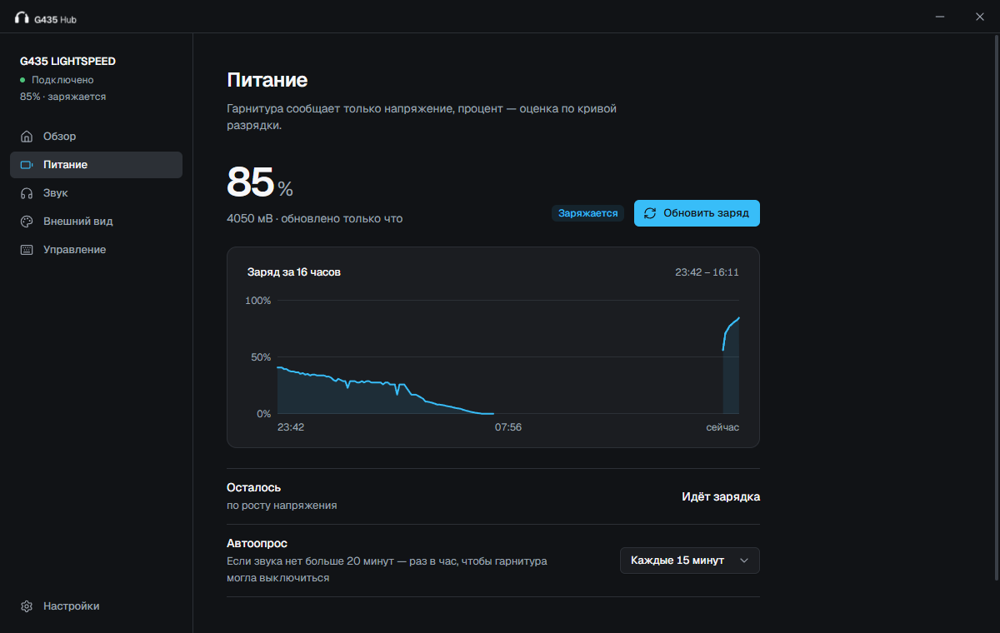
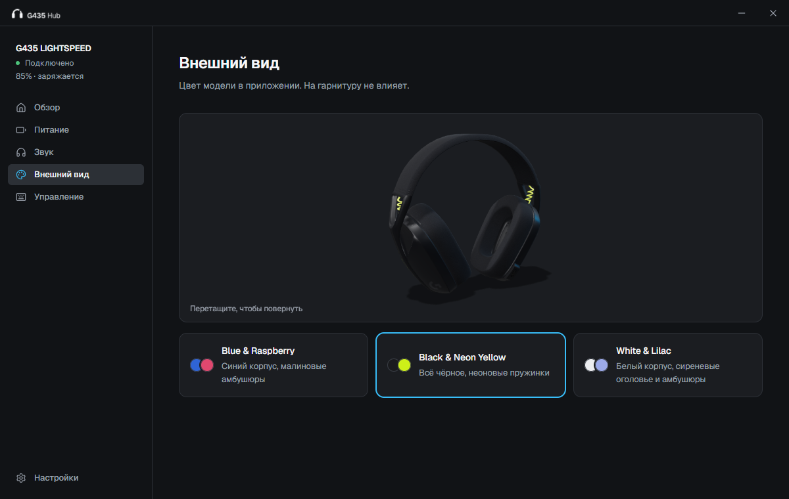
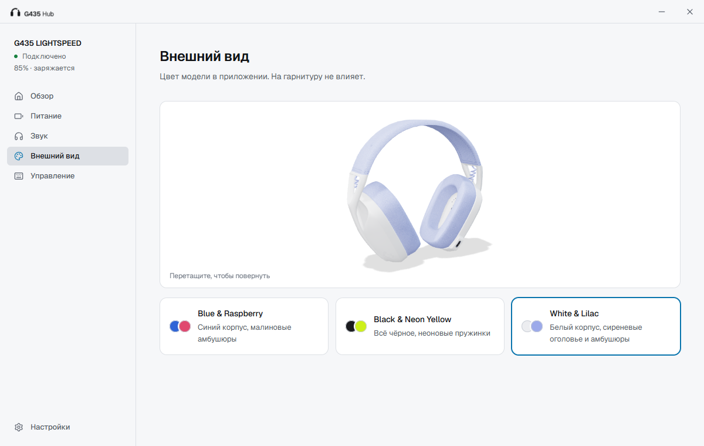

<div align="center">



<br>

[](https://github.com/minchiki/g435-hub/releases/latest)
[](https://github.com/minchiki/g435-hub/releases)
[](LICENSE)


**English** · [Русский](README.ru.md)

</div>

# G435 Hub

Logitech makes no app for the **G435 LIGHTSPEED** headset, and G HUB does not list it. G435 Hub fills the gap:
it shows the **battery level**, sets the **volume**, and spins a **3D model** of your headset, in a small
native app that costs about **6 MB** of RAM while it sits in the tray.

<p align="center"><a href="https://github.com/minchiki/g435-hub/releases/latest"><b>⬇&nbsp;&nbsp;Download the latest release</b></a></p>

<table>
  <tr>
    <td width="50%"></td>
    <td width="50%"></td>
  </tr>
  <tr>
    <td width="50%"></td>
    <td width="50%"></td>
  </tr>
</table>

> The interface is currently in **Russian** only. The screenshots show the real app with real readings.

## Features

- **Battery.** Voltage in mV, a percentage, an estimate of time left, a charging indicator and a 24-hour chart
  (history is kept for 7 days). A Windows notification warns you at a threshold you choose and again at 5 %.
- **Tray.** The charge is drawn right in the tray icon as digits with a level bar. Closing the window really
  closes it, and only a ~6 MB process stays behind.
- **Sound.** Volume and mute for the G435 headphones and microphone.
- **3D model.** Drag to rotate. Three colorways: Blue & Raspberry, Black & Neon Yellow, White & Lilac.
- **Light and dark themes**, start with Windows straight into the tray, a quick guide to the headset's
  button combinations.
- **Gentle on the headset.** Scheduled reads wait for a pause in the audio, and after 20 minutes of silence
  the app polls only once an hour so the headset's own auto-off timer is not kept awake.

**What it cannot do:** sidetone, the volume limiter, auto-off and hardware mic mute live in the headset's
firmware, and nobody has found USB commands for them. The app does not pretend otherwise.

## Install

Download a file from the [latest release](https://github.com/minchiki/g435-hub/releases/latest):

| File | Use it when |
|---|---|
| `G435-Hub_*_x64-setup.exe` | **You just want it installed.** Per-user install, no administrator rights. |
| `G435-Hub_*_x64.msi` | You manage PCs or want a silent install: `msiexec /i G435-Hub_*_x64.msi /qn`. |
| `G435-Hub_*_x64-portable.zip` | You prefer no installation: unzip and run `G435 Hub.exe`. |

Requirements: Windows x64 and the WebView2 Runtime (already part of Windows 11; the installer fetches it on
Windows 10 if missing). Plug in the G435 dongle, switch the headset on, start the app.

**SmartScreen.** The builds are not code-signed (a certificate costs money and this is a hobby project), so
Windows may say "Windows protected your PC" on first run. Choose *More info → Run anyway*. You can verify a
download against `SHA256SUMS.txt`, or [build it yourself](#build-from-source).

**Only Windows.** The app reads the dongle through the Windows HID API and controls volume through Windows
Core Audio, so there are no macOS or Linux builds. The battery protocol itself is portable; a port would need
those two parts rewritten.

## How the battery number works

The headset reports only its **battery voltage**, nothing else. The percentage is an **estimate** from a Li-Po
discharge curve, so treat it as a good guide, not a fuel gauge:

- it is smoothed over several readings and never rises while discharging;
- "charging" is inferred from the voltage rising, since no command for it is known;
- while charging the percentage reads high, because voltage under charge current sits above the resting voltage;
- the bottom of the curve was calibrated on one real discharge of one headset; the 3.70–3.72 V plateau is flat,
  so the percentage is coarse there.

The full protocol, the algorithm and the calibration data are in [docs/battery.md](docs/battery.md). The app
sends only six documented commands to the dongle, and never any unknown vendor command. Reading the battery
sets the dongle to the mode that answers properly (mode 1); that setting persists on the dongle. Audio may
drop for about a second during a read.

## FAQ

**Does it work with other headsets?** It was built and tested on one G435 with dongle `046D:0ACB`. Other
Logitech models use other protocols; do not expect them to work.

**Why does Windows show a notification "from PowerShell"?** The app is not packaged as a Store app, so Windows
may attribute toasts to a generic host. This has not been checked on every setup.

**Where is my data?** `%APPDATA%\local.g435hub\` holds the battery history and settings (two small JSON
files). Nothing leaves your PC; the app makes no network requests.

**How do I remove it?** Uninstall from Windows *Settings → Apps*, or delete the portable folder. Delete
`%APPDATA%\local.g435hub\` to remove the history, and turn off *Start with Windows* in the app first.

## Build from source

You need Rust (stable, MSVC toolchain) and Node.js 20+ (only to run the Tauri CLI):

```powershell
git clone https://github.com/minchiki/g435-hub
cd g435-hub/hub
cargo test --release              # unit tests, including real discharge and charge data
cargo build --release             # hub/target/release/g435-hub.exe (portable binary)
npx @tauri-apps/cli@2 build       # installers in hub/target/release/bundle/
```

The `x86_64-pc-windows-gnu` toolchain also works, but needs MinGW-w64 on `PATH` and a build directory with
no spaces in its path (`CARGO_TARGET_DIR`), because `windres` cannot handle spaces. Cargo does not notice a
changed `hub/icons/icon.ico`: run `cargo clean --release -p g435-hub` after editing it.

Release builds are made by [GitHub Actions](.github/workflows/release.yml) when a `v*` tag is pushed.

<details>
<summary><b>Project layout</b></summary>

| Path | What is there |
|---|---|
| `hub/src` | Rust: `hid.rs` (dongle protocol), `battery.rs` (estimation), `worker.rs` (background thread), `audio.rs` (Core Audio), `tray.rs`, `autostart.rs`, `main.rs` |
| `hub/ui` | The interface: `tokens.css` (design tokens, light and dark), `components.css` and `components.html` (every component state), `app.css`, `index.html`, `app.js`, vendored three.js, Geist font, Lucide icons, logo in `brand/` |
| `scripts/build_model.py` | Builds the model assets from the source GLB (numpy, Pillow): pixel classes → colorways, per-material roughness map |
| `scripts/build_icon.py`, `build_logo.mjs` | App icon (one hand-tuned frame per size) and logo files |
| `scripts/battery.py` | The same battery read from the command line, no dependencies |
| `docs/battery.md` | Protocol, estimation algorithm, calibration |

</details>

## Credits

- Battery protocol: [deddroid/logitech-g435-battery](https://github.com/deddroid/logitech-g435-battery) (MIT)
  and [endes' write-up](https://dev.to/endes/usb-hid-down-the-rabbit-hole-logitech-g435-dongle-33if).
- 3D model: [“Fone Logitech G435”](https://sketchfab.com/3d-models/fone-logitech-g435-d4cc71d02f6f40a48441f9045fe4e1ae)
  by VagnerZNMods, [CC BY 4.0](http://creativecommons.org/licenses/by/4.0/), recoloured and re-textured here.
- [Tauri](https://tauri.app), [three.js](https://threejs.org), [Geist](https://vercel.com/font),
  [Lucide](https://lucide.dev).

See [THIRD-PARTY-NOTICES](THIRD-PARTY-NOTICES). G435 Hub is an unofficial project and is not affiliated with
Logitech; Logitech, G435 and LIGHTSPEED are trademarks of their owners.

Code: [MIT](LICENSE). The 3D model keeps its own CC BY 4.0 license.

---

<p align="center">More projects: <a href="https://t.me/huicoding">HUICODING</a></p>
