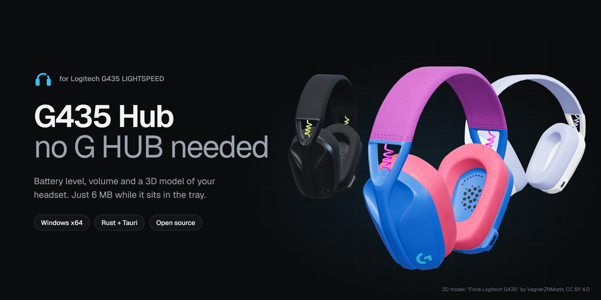
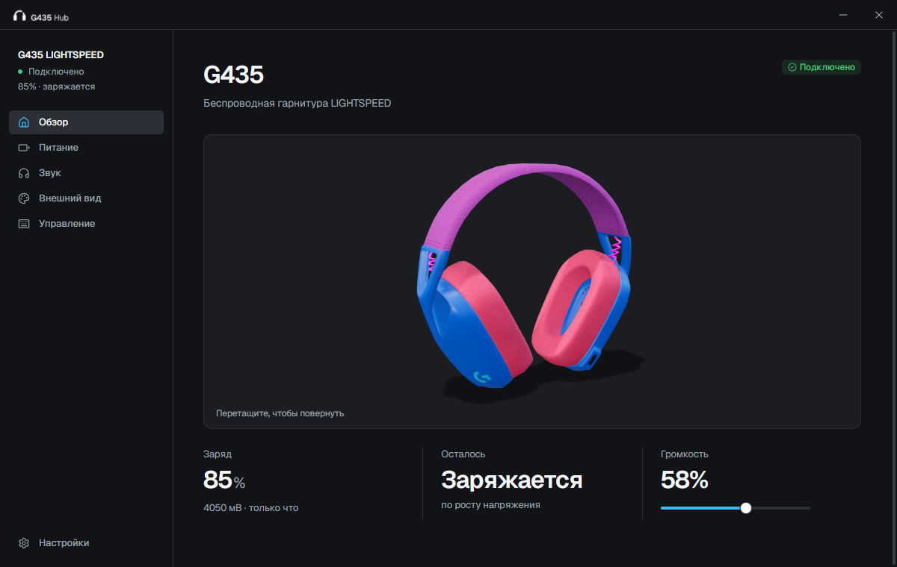
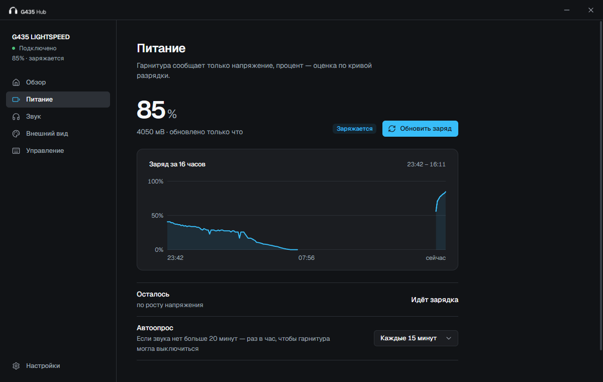
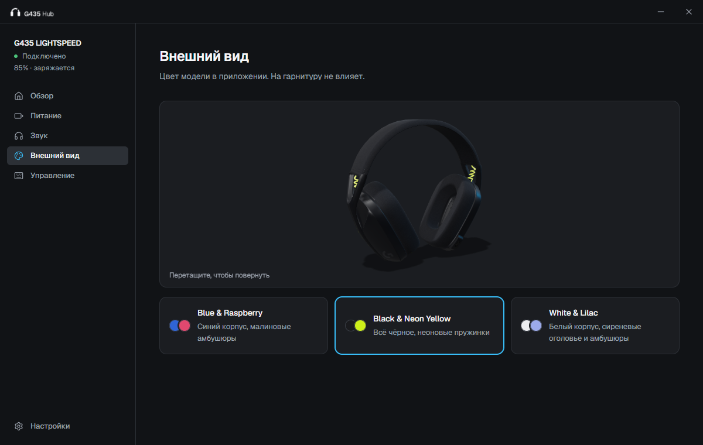
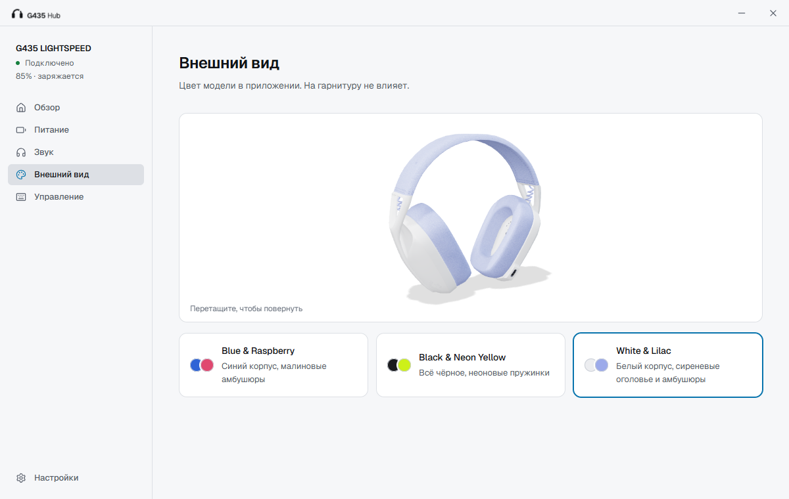

<div align="center">



<br>

[](https://github.com/minchiki/g435-hub/releases/latest)
[](https://github.com/minchiki/g435-hub/releases)
[](LICENSE)


[English](README.md) · **Русский**

</div>

# G435 Hub

Для гарнитуры **Logitech G435 LIGHTSPEED** у Logitech нет программы, а в G HUB её не видно. G435 Hub закрывает
этот пробел: показывает **заряд**, регулирует **громкость** и крутит **3D-модель** вашей гарнитуры. Это небольшое
нативное приложение, которое в трее занимает около **6 МБ** памяти.

<p align="center"><a href="https://github.com/minchiki/g435-hub/releases/latest"><b>⬇&nbsp;&nbsp;Скачать последнюю версию</b></a></p>

<table>
  <tr>
    <td width="50%"></td>
    <td width="50%"></td>
  </tr>
  <tr>
    <td width="50%"></td>
    <td width="50%"></td>
  </tr>
</table>

> Скриншоты сделаны в настоящем приложении, на реальных показаниях.

## Возможности

- **Заряд.** Напряжение в мВ, процент, оценка «осталось ≈ N ч», признак зарядки и график за сутки
  (история хранится 7 дней). Уведомление Windows приходит на выбранном вами пороге и ещё раз на 5 %.
- **Трей.** Заряд нарисован прямо в значке: цифры и полоска уровня. Крестик закрывает окно по-настоящему,
  в памяти остаётся процесс около 6 МБ.
- **Звук.** Громкость и mute наушников и микрофона G435.
- **3D-модель.** Тяните мышью, чтобы повернуть. Три расцветки: Blue & Raspberry, Black & Neon Yellow,
  White & Lilac.
- **Светлая и тёмная темы**, автозапуск с Windows сразу в трей, справка по кнопочным комбинациям гарнитуры.
- **Бережно к гарнитуре.** Плановое чтение ждёт паузы в звуке, а после 20 минут тишины приложение опрашивает
  гарнитуру раз в час, чтобы не мешать её собственному автовыключению.

**Чего нет:** sidetone, ограничитель громкости, автовыключение и аппаратный mute микрофона живут в прошивке
гарнитуры, а USB-команд для них никто не нашёл. Приложение не делает вид, что умеет это.

## Установка

Скачайте файл из [последнего релиза](https://github.com/minchiki/g435-hub/releases/latest):

| Файл | Когда выбирать |
|---|---|
| `G435-Hub_*_x64-setup.exe` | **Нужно просто поставить.** Установка для текущего пользователя, права администратора не нужны. |
| `G435-Hub_*_x64.msi` | Вы администрируете компьютеры или нужна тихая установка: `msiexec /i G435-Hub_*_x64.msi /qn`. |
| `G435-Hub_*_x64-portable.zip` | Без установки: распаковать и запустить `G435 Hub.exe`. |

Требования: Windows x64 и WebView2 Runtime (в Windows 11 он уже есть; на Windows 10 установщик скачает его,
если нет). Вставьте донгл G435, включите гарнитуру, запустите приложение.

**SmartScreen.** Сборки не подписаны кодовой подписью (сертификат стоит денег, а это хобби-проект), поэтому при
первом запуске Windows может написать «Система Windows защитила ваш компьютер». Нажмите *Подробнее → Выполнить
в любом случае*. Скачанный файл можно сверить с `SHA256SUMS.txt` или [собрать самому](#сборка-из-исходников).

**Только Windows.** Донгл читается через Windows HID API, а громкость управляется через Windows Core Audio,
поэтому сборок для macOS и Linux нет. Сам протокол чтения заряда переносим; для порта нужно переписать эти две части.

## Как считается заряд

Гарнитура сообщает только **напряжение батареи**, больше ничего. Процент — **оценка** по кривой разряда Li-Po,
поэтому это хороший ориентир, а не топливомер:

- процент сглажен по нескольким замерам и при разрядке не растёт;
- «заряжается» — вывод по росту напряжения, команды для этого никто не нашёл;
- на зарядке процент завышен: напряжение под током зарядки выше напряжения покоя;
- низ кривой откалиброван по одной реальной разрядке одной гарнитуры; на плато 3,70–3,72 В напряжение почти
  не меняется, поэтому там процент грубый.

Протокол, алгоритм и данные калибровки — в [docs/battery.ru.md](docs/battery.ru.md). Приложение отправляет донглу
только шесть описанных команд и никогда не отправляет неизвестные команды производителя. Чтение заряда
переключает донгл в режим, в котором он отвечает корректно (режим 1); эта настройка остаётся на донгле.
Во время чтения звук может пропасть примерно на секунду.

## Вопросы и ответы

**Работает ли с другими гарнитурами?** Приложение сделано и проверено на одной G435 с донглом `046D:0ACB`.
У других моделей Logitech другие протоколы, рассчитывать на них не стоит.

**Почему уведомление Windows приходит «от PowerShell»?** Приложение не упаковано как приложение Магазина,
поэтому Windows может приписывать уведомления общему узлу. Проверено не на всех конфигурациях.

**Где мои данные?** В `%APPDATA%\local.g435hub\`: история заряда и настройки (два маленьких JSON-файла).
Ничего не уходит с компьютера, приложение не делает сетевых запросов.

**Как удалить?** Через *Параметры → Приложения* или удалением папки портативной версии. Историю удалит удаление
`%APPDATA%\local.g435hub\`; перед этим выключите в приложении «Запускать с Windows».

## Сборка из исходников

Нужны Rust (stable, тулчейн MSVC) и Node.js 20+ (только для Tauri CLI):

```powershell
git clone https://github.com/minchiki/g435-hub
cd g435-hub/hub
cargo test --release              # тесты, в том числе на реальных данных разрядки и зарядки
cargo build --release             # hub/target/release/g435-hub.exe (портативный бинарник)
npx @tauri-apps/cli@2 build       # установщики в hub/target/release/bundle/
```

Тулчейн `x86_64-pc-windows-gnu` тоже подходит, но нужен MinGW-w64 в `PATH` и каталог сборки без пробелов
в пути (`CARGO_TARGET_DIR`): `windres` не переносит пробелы. Cargo не замечает смену `hub/icons/icon.ico`:
после правки выполните `cargo clean --release -p g435-hub`.

Релизные сборки делает [GitHub Actions](.github/workflows/release.yml) при отправке тега `v*`.

<details>
<summary><b>Структура проекта</b></summary>

| Путь | Что там |
|---|---|
| `hub/src` | Rust: `hid.rs` (протокол донгла), `battery.rs` (оценка заряда), `worker.rs` (фоновый поток), `audio.rs` (Core Audio), `tray.rs`, `autostart.rs`, `main.rs` |
| `hub/ui` | Интерфейс: `tokens.css` (дизайн-токены, светлая и тёмная темы), `components.css` и `components.html` (все состояния компонентов), `app.css`, `index.html`, `app.js`, three.js, шрифт Geist, иконки Lucide, логотип в `brand/` |
| `scripts/build_model.py` | Сборка ассетов модели из исходного GLB (numpy, Pillow): классы пикселей → расцветки, карта шероховатости по материалам |
| `scripts/build_icon.py`, `build_logo.mjs` | Иконка приложения (свой кадр на каждый размер) и файлы логотипа |
| `scripts/battery.py` | То же чтение заряда из командной строки, без зависимостей |
| `docs/battery.ru.md` | Протокол, алгоритм оценки, калибровка |

</details>

## Благодарности

- Протокол чтения заряда: [deddroid/logitech-g435-battery](https://github.com/deddroid/logitech-g435-battery) (MIT)
  и [разбор endes](https://dev.to/endes/usb-hid-down-the-rabbit-hole-logitech-g435-dongle-33if).
- 3D-модель: [«Fone Logitech G435»](https://sketchfab.com/3d-models/fone-logitech-g435-d4cc71d02f6f40a48441f9045fe4e1ae)
  автора VagnerZNMods, [CC BY 4.0](http://creativecommons.org/licenses/by/4.0/), здесь перекрашена и перетекстурирована.
- [Tauri](https://tauri.app), [three.js](https://threejs.org), [Geist](https://vercel.com/font),
  [Lucide](https://lucide.dev).

См. [THIRD-PARTY-NOTICES](THIRD-PARTY-NOTICES). G435 Hub — неофициальный проект, не связанный с Logitech;
Logitech, G435 и LIGHTSPEED — товарные знаки их владельцев.

Код: [MIT](LICENSE). У 3D-модели своя лицензия CC BY 4.0.

---

<p align="center">Больше проектов: <a href="https://t.me/huicoding">HUICODING</a></p>
